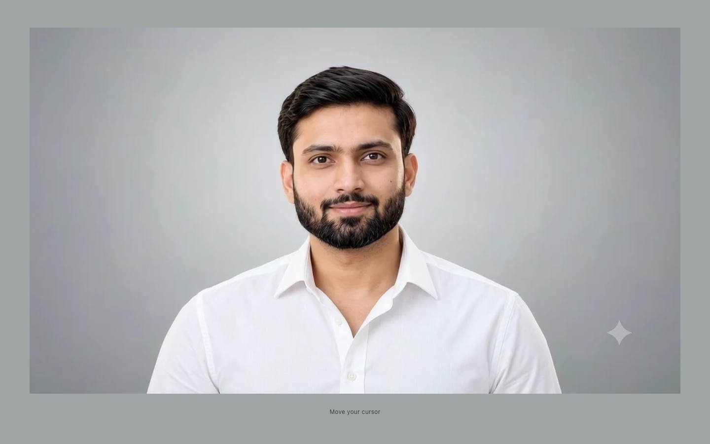
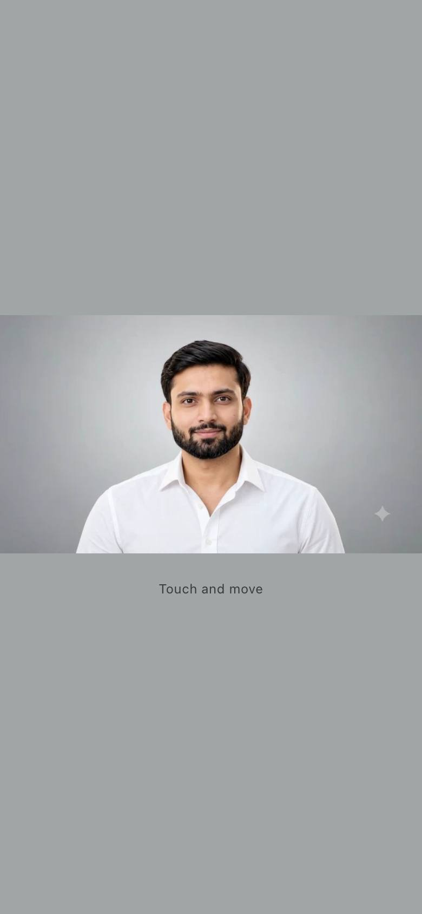

# Cursor-controlled portrait prototype

> Research prototypes for a cursor-controlled cinematic portrait — head tracking, pose atlases and video-driven experiments, one version per folder.

<p align="center">
  
  
</p>


A standalone React + TypeScript + Vite experiment using only frames from the supplied 10-second video. It contains a reusable `HeadTracker` component and no portfolio sections.

## Run locally

```sh
npm install
npm run dev
```

Open http://127.0.0.1:5173. Move your cursor across the viewport. On touch devices, touch and drag; release to return to center.

Development diagnostics: http://127.0.0.1:5173/?debug=1. Shows the active source filename, normalized coordinates, target direction, source timestamp/frame, smoothing state, rendering method, approximate animation-loop FPS, preload status, grid toggle, and smoothing toggle. The FPS is the animation-loop rate, not a claim that there are that many distinct source poses per second. Production builds exclude the debug interface.

## Validate and build

```sh
npm run lint
npm run typecheck
npm run build
npm run preview
```

To rerun browser QA, keep the dev server running and execute `npm run qa`. The test uses an installed Google Chrome, creates temporary headless sessions, and writes screenshots plus a JSON report into `qa/`. It tests all nine directions at the five requested viewport sizes, rapid movement, cursor exit, debug controls, reduced motion, mobile touch emulation, and a source-video seek benchmark. Mobile emulation is not real-device testing.

## Source and configuration

- `src/HeadTracker.tsx`: reusable portrait component; listeners and Canvas 2D lifecycle.
- `src/tracking.ts`: coordinate normalization, easing, directional selection, and source-pose gating.
- `src/frameCache.ts`: bounded-concurrency preload and decoded image cache.
- `src/poses.json`: exact selected timestamps plus approximate intermediate pose annotations.
- `public/frames/flow-1218/`: 37 images per resolution derived solely from `Man_moving_head_in_studio_20261009121811.mp4`; provenance manifest.
- `scripts/extract-frames.py`: reproducible extraction using FFmpeg and cwebp. Run `python3 scripts/extract-frames.py` to regenerate assets. Temporary PNGs are deleted after successful compression.
- `analysis/FLOW-UPGRADE.md`: active video inspection, source limitations, and rendering rationale. `VIDEO-ANALYSIS.md` is retained historical analysis.
- `qa/QA.md`: validation summary and screenshots.

Both original MP4s stay at the project root, untouched. The production app uses only the new clip's derived images and has no video playback or external image/AI service. To embed later, import `HeadTracker`, its styles, and deploy the frame assets under Vite's configured base URL.

## Comparison and rollback

Old and new nine-direction browser boards and the focused eye comparison are in `qa/comparison/`. Both use identical cursor coordinates, 1440×900 viewport, DPR 2, and fixed crop positions. Run `python3 scripts/compare-captures.py` after browser QA to regenerate the boards; this optional analysis script requires Pillow.

The old atlas, mapping, changed source modules, original styling, extraction/test scripts, HTML, documentation, and screenshots are preserved in `rollback/original-68/`. To roll back explicitly, replace `public/frames/` with that snapshot's `public/frames/`, restore its saved `src/` files, `index.html`, and `scripts/` files, then restart Vite and rebuild. Keep the ESLint rollback-directory ignore. The active application currently loads only the new namespace. No runtime dependencies were added.

## Limitations

The directional audit in `analysis/direction-audit/REVIEW.md` rejects the current DOWN and LOWER-RIGHT frames: the former looks essentially forward, the latter rightward/slightly upward. Both require suitable new source footage; eye openness alone is insufficient. Lower-left remains a usable modest down-left pose. Runtime selection is preserved pending a valid clip, so those two known visual inaccuracies remain. Right yaw is weaker than before; upper-right includes some head roll. Some center/opposite changes and middle-sweep gaps remain discrete. Slight expression, shirt, and position changes and the diamond artifact remain in the source. Images are never facially crossfaded or artificially interpolated. Desktop assets stay 960 pixels wide to limit decoded memory; large high-DPI screens may look softer than the original.
