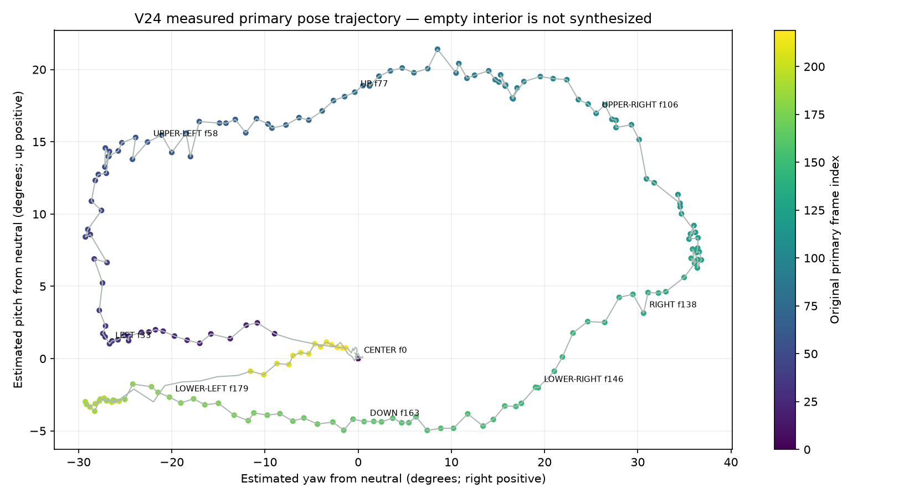
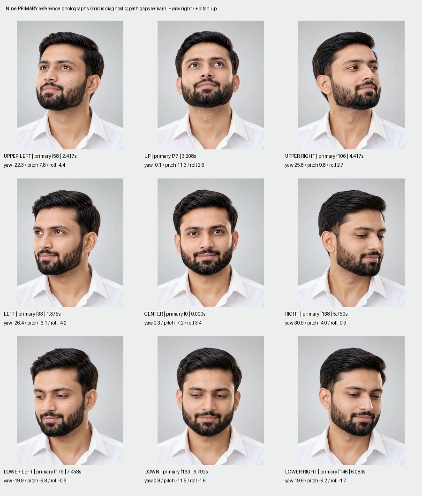
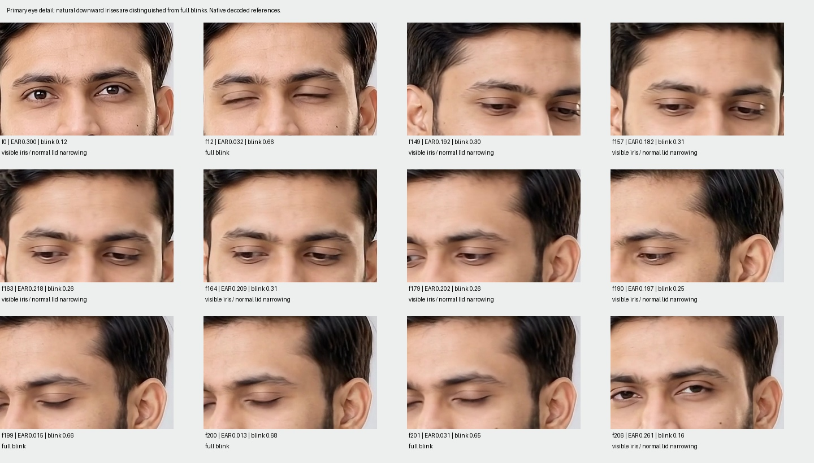
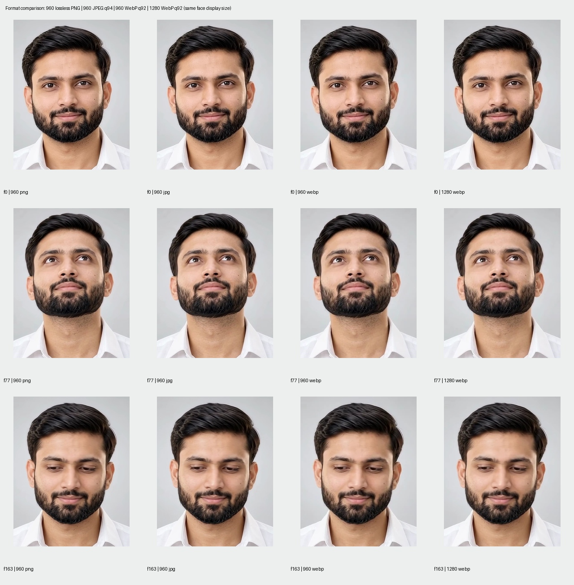
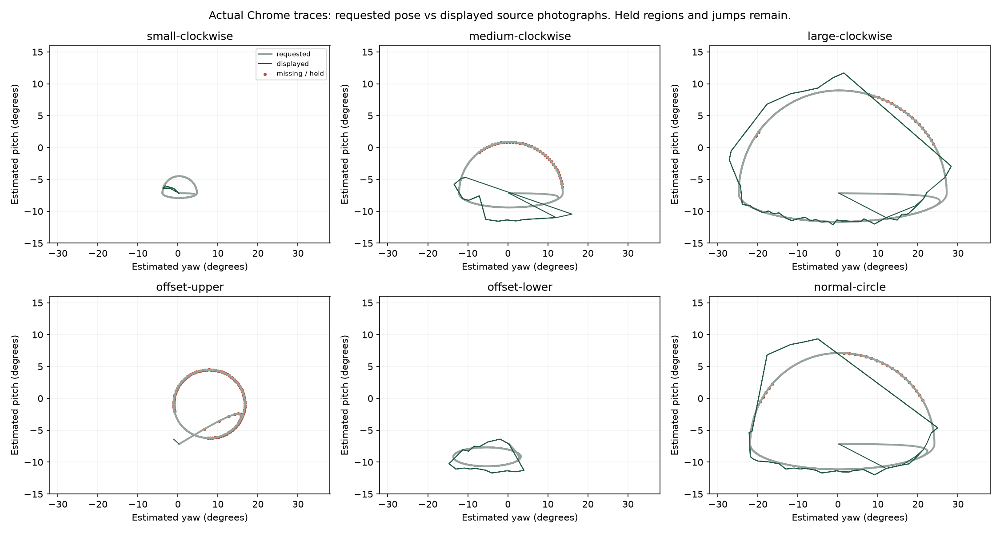
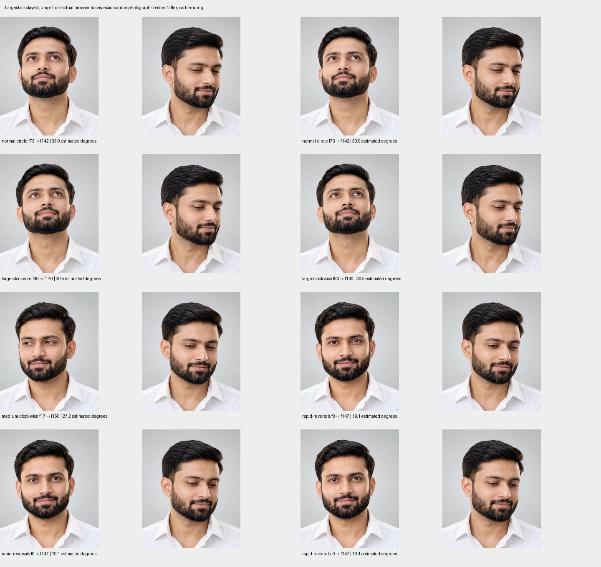

# V24 — Primary-video photographic cursor tracking

**NO-GO for natural two-dimensional tracking across arbitrary circles.** The isolated prototype works, preserves the preferred primary video's photographic character, and exposes usable directional photographs. It does not demonstrate the required continuous circular head response. The recording shows held poses and abrupt source-image changes; adding smoothing or PixiJS would not supply the missing photographs. Nothing is promoted.

This verdict is specific to the requested general cursor experience. Portions of the actual primary trajectory are graceful, the lower arc contains naturally visible downward irises, and small movements are stable. Those successes are retained as working inspection modes rather than discarded.

## Preview and evidence

- [A — chronological extracted-image reference](http://127.0.0.1:4324/?mode=A)
- [B — primary-only cursor atlas](http://127.0.0.1:4324/?mode=B)
- [C — reviewed repair atlas](http://127.0.0.1:4324/?mode=C)
- [B/C — identical-input side-by-side comparison](http://127.0.0.1:4324/?compare=1)
- [Evidence page](http://127.0.0.1:4324/evidence/)
- [58.2-second normal-speed B/C circular recording](../qa/recordings/circular-B-vs-C.webm), [actual mouse circle recording](../qa/recordings/real-mouse-circles-B.webm), [chronological A recording](../qa/recordings/chronological-A.webm)

C has **zero approved secondary repairs**, so it intentionally uses B's approved primary library. The comparison does not claim a repair advantage. D was not added: B/C did not pass the source-quality gate. The requested 20/35/50ms values were nevertheless compared once, as part of the controller evaluation.

## Isolation and preservation

All generated scripts, images, manifests, source audit, browser assets, recordings and reports reside in `v24-primary-video-cursor-tracking`. The baseline fingerprints **37,414 pre-existing files, 7,095,630,738 bytes**, including all original MP4s, the root implementation, frozen standalone prototypes, V14/V15, V18/V19/V20, dependencies and rollback assets. The final preservation result is `True`; see [preservation-after.json](preservation-after.json) and the complete [baseline](preservation-before.json). The supplied folder has no `.git` directory; there are no local commits/tags to enumerate or modify. Existing rollback files are protected by the byte comparison.

Node modules are reused through a V24-local symlink to the existing V20 installation, read-only in this experiment; Vite cache is explicitly redirected into V24/data. Python uses the existing V18 environment with bytecode writing disabled; the official model is copied into V24 and freshly run on V24's independent extractions. No earlier audit result is used as the new measurement. Package and Python lockfiles are retained locally. No original MP4 is served to the renderer or changed.

## Complete original-video inventory

Root discovery found **19 independent original candidates and one excluded derived V20 preview**. Original provenance is inferred from descriptive Google Flow download filenames and visuals, not verified against an external generation account. All 19 are 1920×1080 H.264 sources at the original 24/1 FPS. Source s07 has 239 decoded frames; every other candidate has 240. Total: **4,559 native JPEGs**, including **240 primary** and **4,319 secondary**. The exclusion and its checksum are retained in [excluded-videos.json](../data/excluded-videos.json).

All frames were extracted with FFmpeg `-map 0:v:0 -fps_mode passthrough -q:v 1 -start_number 0`. There is no FPS filter or resampling. Native primary photographs are `data/primary/original-jpg/frame_000000.jpg` through `frame_000239.jpg`; each secondary source has its own original-jpg folder. Original FFprobe presentation timestamps and native dimensions are preserved in [inventory.json](../data/inventory.json) and [source-frame-manifest.json](../data/source-frame-manifest.json).

| ID / filename | Duration / frames | SHA-256 |
| --- | --- | --- |
| primary · Generate_video_from_image_reference_20261009112404.mp4 | 10.000000s / 240 | 0d13499bdd9375a01cd21586fe483dac997b0d66b62769bfd3b5bd0f05143dd8 |
| s01 · Creating_studio_portrait_video_1080p_20261009170410.mp4 | 10.000000s / 240 | ab35fc4c372c28c1019ae77488fe61a9d9dc0674f556e1f2efcc051e1206e283 |
| s02 · Integrating_down_video_prototype_1080p_20261009181612.mp4 | 10.000000s / 240 | 99c0d51b924da7f6ea33ef73ca0fa8cba3abfded037cbef564302fc025d0b145 |
| s03 · Man_adjusting_gaze_in_studio_20261012112950.mp4 | 10.000000s / 240 | 7deb47427c41cf6b1b1d30580f7bb7fe8aa02cdd6e466417c6aeb68d769e1cd0 |
| s04 · Man_lowering_chin_in_studio_20261009180859.mp4 | 10.000000s / 240 | 8a5ce0fa3e557fea26bd5b4555a902af205a3e73b9081cea38eb81bfcff511bc |
| s05 · Man_moving_head_in_studio_20261009121811.mp4 | 10.000000s / 240 | e0c5971cfc5b306c3dfea459d7ed438447fc7ed5f97df18ac500a549b7c7694e |
| s06 · Man_moving_head_in_video_20261009183521.mp4 | 10.000000s / 240 | c827881c863bc22219ade63193ebb68e849731c8db59eed6115d42b17b35b4f4 |
| s07 · Man_moving_head_right_1080p_20261012114645.mp4 | 9.958333s / 239 | c9611dbb3889b46f96c21e6f9843996dcf5ac1bc368c72870be43e3ef1316c41 |
| s08 · Man_moving_head_right_1080p_20261012115345.mp4 | 10.000000s / 240 | 5839f88db87f839bdddec4eab61f55d4e85c4bd1e5ab062f614b37f860ff6d48 |
| s09 · Man_raising_chin_in_studio_20261009201213.mp4 | 10.000000s / 240 | d9a0b101dbb2203c691fe2a102e4df2f7d96982dfa60749fc76da3dccfceac1a |
| s10 · Man_recording_head_motion_video_20261009181837.mp4 | 10.000000s / 240 | 51c2f441c7ad31bb7dd942374e20aa42e22d0fe6af9fc33963a1e5311ec76c4d |
| s11 · Man_rotating_head_in_studio_20261013111545.mp4 | 10.000000s / 240 | cb407824cbfeb80c4bd15e3730d6a814cbfccd3ab733d82561e293304c498a99 |
| s12 · Man_rotating_head_in_studio_20261013111707.mp4 | 10.000000s / 240 | f06c5c4aa37d2fb55451dbf47441f44b3a6fe2ee907acc32709f553bc3565505 |
| s13 · Man_turning_head_rightward_1080p_20261009193414.mp4 | 10.000000s / 240 | 1ff206c8aa30fcab83840a756c2f1627374757b227f42543016308cddae02b23 |
| s14 · Person_moving_head_in_video_20261014084350.mp4 | 10.000000s / 240 | a68dbcb48859882af9e2a0f231c595fce0f5e4928297a44b9e203b26057a6e4a |
| s15 · Person_moving_head_in_video_20261014084521.mp4 | 10.000000s / 240 | cab04c20a285fdf2862e0a177056f8976a5fb317642fa6e0f62502ae446d1624 |
| s16 · Person_portrait_head_movement_video_20261014085457.mp4 | 10.000000s / 240 | 8d01e037edd1518b03e12a45eaa9939d747bec8e1a762016eb6aaf4591a12a39 |
| s17 · Person_portrait_head_movement_video_20261014085626.mp4 | 10.000000s / 240 | bdb75069037588359ca26a7baf18fb67f575a2e8f1c689a4861c2a99b56d8069 |
| s18 · Studio_video_head_rotation_1080p_20261012183246.mp4 | 10.000000s / 240 | 83514ce87510581b618a570ef27808839ffd1342b8408263961da25870cf0a0d |

The full machine-readable inventory also includes FPS, resolution, codec, source bytes and extracted bytes. [CSV](source-inventory.csv).

## Primary-video frame audit and actual sequence

All **240** primary photographs were quantitatively measured and visually inspected across [eight chronological sheets](contact-sheets/primary-all/000000.jpg), each showing 30 individual frames, plus enlarged eye, directional and compression comparisons. [Per-frame audit CSV](primary-frame-audit.csv), [full annotated primary manifest](../data/primary/frame-manifest.json), [visual review record](../data/visual-review.json).

MediaPipe measures canonical-model Euler yaw/pitch/roll, eye aspect ratios, blink blendshape scores, relative iris positions, facial landmarks, face scale/translation, expression proxies, sharpness and temporal pixel differences in face/beard, collar, shoulder and background regions. Every row retains its original index and timestamp. Region MAE and landmarks are screening proxies; they are not calibrated body pose, identity verification or a proof of photographic compatibility. The pose signs were checked against visible nose and cheek orientation. Eye direction is recorded separately from head orientation.

| Primary frames / time | Actual visual sequence and limitation |
| --- | --- |
| 0–10 / 0.000–0.417s | Neutral hold, open eyes; f0 selected, redundant photographs omitted. |
| 11–15 / 0.458–0.625s | Blink and gaze shift during initial left departure; rejected. |
| 16–38 / 0.667–1.583s | Graceful left yaw; source roll gradually reaches roughly -5 degrees. |
| 39–55 / 1.625–2.292s | Upper-left transition; head pitch increases naturally, modest source roll. |
| 56–64 / 2.333–2.667s | Gaze shifts upward/right ahead of head yaw; independent eye movement remains. |
| 65–94 / 2.708–3.917s | Upper sweep across frontal yaw; no corresponding neutral-to-upper interior. |
| 95–135 / 3.958–5.625s | Upper-right to right arc; far-eye narrowing is not classified as a blink. |
| 136–197 / 5.667–8.208s | Right to shallow down to lower-left arc; visible downward irises with eyelid narrowing, no full blink. |
| 198–205 / 8.250–8.542s | Blink/partial reopening during lower-left return; excluded; missing bridge disclosed. |
| 206–219 / 8.583–9.125s | Open-eye return toward neutral; minor gaze/roll differences remain. |
| 220–239 / 9.167–9.958s | Redundant neutral hold; not loaded into tracking atlas. |

Raw estimates span yaw **-29.0° to 37.1°**, pitch **-12.1° to 14.2°**, and absolute roll at most **5.7°**. Neutral itself measures yaw 0.31°, pitch -7.17°, roll 3.39°. These systematic offsets make relative-to-neutral interpretation necessary. No roll is manufactured or substituted for yaw.

## Coverage, nine directions and missing interior

The source traces a broad perimeter and a shallow lower path. Strongest regions are left yaw, upper-left arc, upper sweep and the right-to-lower arc along their recorded trajectories. DOWN is a modest real chin lowering with visible downward irises; it is not a deep open-eye look downward. Missing or weak regions include the central upper interior, neutral-to-UP bridge, portions of the right/central interior and the blink-covered late lower-left return. Independent gaze shifts near frames 56–64 remain visible even while the head path is graceful.

The runtime requests −28° to +30° yaw relative to neutral, +18° upward pitch and only −5° downward pitch. This asymmetric mapping reflects the source; it does not establish a symmetric physical motion range. Coverage proximity on a 41×41 grid is 79.6% under the explicit .23 yaw/30, pitch/18 distance gate. **This is not a smoothness score:** a near photograph can still belong to a disconnected path or have different eyes. The circular tests below expose that distinction.

| Requested direction | Nearest reference frame | Estimated raw yaw / pitch | Distance gate error |
| --- | --- | --- | --- |
| CENTER | 0 | 0.3° / -7.2° | 0.000 |
| LEFT | 33 | -26.4° / -6.1° | 0.072 |
| RIGHT | 138 | 30.9° / -4.0° | 0.176 |
| UP | 77 | -0.1° / 11.3° | 0.027 |
| DOWN | 163 | 0.9° / -11.5° | 0.042 |
| UPPER-LEFT | 58 | -22.3° / 7.8° | 0.058 |
| UPPER-RIGHT | 106 | 25.8° / 9.8° | 0.178 |
| LOWER-LEFT | 179 | -19.9° / -9.8° | 0.087 |
| LOWER-RIGHT | 146 | 19.6° / -9.2° | 0.172 |

Each direction has its own 18-photo [direction contact sheet](contact-sheets/directions/CENTER.jpg). Browser-selected indices are retained in qa/browser-results.json and direction screenshots; continuity and hysteresis can pick a nearby photograph rather than exactly the static nearest reference above. Nine visible endpoints do not establish valid transitions between them.

## Eye, blink and gaze anomalies / DOWN decisions

Full blinks are visually confirmed at primary frame 12 (0.500s) and frames 199–201 (8.292–8.375s). Their minimum eye-aspect ratios are roughly .013–.032 and the irises are not usefully visible. Frames 11–15 and 198–205 include closure or partial reopening and are omitted from tracking. The intervening lower arc, roughly frames 136–197, contains visible irises directed downward under narrowed upper lids. This is natural downward gaze plus eyelid narrowing / pitch occlusion, not a continuous blink. Its eye measurements must not be treated as the same class as the full closures.

Primary f163 is the nearest reference DOWN photograph and is a mild preference over f164: nearly the same pose with slightly more visible eyes. Browser continuity can settle on f164 after a transition; it is still a valid visible-iris photograph, not an asserted eye repair. Neither is represented as fully forward-looking eyes. Other nearby primary frames cannot fill the late blink return without changing gaze/roll or making a larger head jump. The excluded frames are not blindly stitched over as if the path were repaired.

The iris proxy is especially unreliable while the eyes close; large vertical jumps near frames 11–13 and 197–203 partly reflect occlusion, not measured eye rotation. On the upper sweep, eyes move independently ahead of head yaw around frames 56–64. The overall source has more than one defect; downward visibility is not the only gate.

No eyes were pasted, independently animated, inferred or synthesized. No face morphing or facial crossfade is used. [DOWN decisions](../data/down-repair-decisions.json).

## Secondary-source compatibility investigation

All 4,319 secondary frames were freshly screened. For each of 18 sources, the best matching eyes-visible candidate for DOWN, LOWER-LEFT and LOWER-RIGHT was compared against primary f164, f184 and f149 respectively: **54 matched-source comparisons**. The six repair contact sheets show these candidates, alongside their primary references. This is not a claim that every secondary photograph was manually inspected. Some candidates are poor yaw matches because that clip has no appropriate direction at all; they remain visibly rejected.

Numerical matching includes yaw/pitch, landmark displacement, gaze, roll, face-scale ratio, face/beard texture MAE, collar, shoulder and background differences. Actual photographic character controls approval. The decision below applies to the entire source's repair investigation, with individual candidate metrics in [secondary-compatibility.json](../data/secondary-compatibility.json). No candidate passed the adjacent-photograph review strongly enough to justify insertion; no runtime repair was claimed or silently swapped in.

| Source | Best tested DOWN candidate | Decision / visual reason |
| --- | --- | --- |
| s01 | frame 43 (Creating_studio_portrait_video_1080p_20261009170410.mp4) | Eyes point toward camera; expression/lid shape changes; does not improve downward-gaze continuity. |
| s02 | frame 29 (Integrating_down_video_prototype_1080p_20261009181612.mp4) | Useful downward/left pose but head/collar and roll change across the source boundary; no complete transition improvement demonstrated. |
| s03 | frame 103 (Man_adjusting_gaze_in_studio_20261012112950.mp4) | Right-facing starting region has no frontal or left downward counterpart; smile/eyes differ. |
| s04 | frame 62 (Man_lowering_chin_in_studio_20261009180859.mp4) | Similar shallow DOWN pose, but roll and lid/expression differ; eyes still naturally lowered; no clear improvement over primary f163. |
| s05 | frame 175 (Man_moving_head_in_studio_20261009121811.mp4) | Face/collar/scale differ; no matching frontal downward pose in this source. |
| s06 | frame 90 (Man_moving_head_in_video_20261009183521.mp4) | Camera-facing gaze changes character of primary downward sweep; face and collar mismatch. |
| s07 | frame 41 (Man_moving_head_right_1080p_20261012114645.mp4) | Only right-side angles; wrong yaw for frontal/left repair, different beard/collar and eyes. |
| s08 | frame 125 (Man_moving_head_right_1080p_20261012115345.mp4) | Right-side-only angles and smile/eye changes; no coherent matching downward transition. |
| s09 | frame 31 (Man_raising_chin_in_studio_20261009201213.mp4) | Right-side starting pose and face/collar differences; does not repair complete lower arc. |
| s10 | frame 68 (Man_recording_head_motion_video_20261009181837.mp4) | Frontal downward option still looks down; deeper chin/roll and collar discontinuity, no improvement over nearby primary. |
| s11 | frame 18 (Man_rotating_head_in_studio_20261013111545.mp4) | Eyes look toward camera with changed smile/eyebrows; repair would introduce independent gaze jump. |
| s12 | frame 13 (Man_rotating_head_in_studio_20261013111707.mp4) | Eyes look toward camera with altered smile; not a matching downward-gaze transition. |
| s13 | frame 232 (Man_turning_head_rightward_1080p_20261009193414.mp4) | Gaze/pose candidates exist but collar/head roll and lighting differ; boundary has no visual continuity advantage. |
| s14 | frame 173 (Person_moving_head_in_video_20261014084350.mp4) | Large lateral roll is conspicuous; it cannot stand in for yaw/pitch. |
| s15 | frame 157 (Person_moving_head_in_video_20261014084521.mp4) | Large lateral roll/tilted eyes plus expression change; a more open iris does not justify it. |
| s16 | frame 178 (Person_portrait_head_movement_video_20261014085457.mp4) | Large roll or expression change, and weak left yaw coverage; no compatible lower arc. |
| s17 | frame 220 (Person_portrait_head_movement_video_20261014085626.mp4) | Predominantly frontal/right and camera-looking eyes; expression changes, no left repair. |
| s18 | frame 186 (Studio_video_head_rotation_1080p_20261012183246.mp4) | Frontal/right source with camera-directed gaze; the primary has the more consistent transition. |

## Selected image library and photographic continuity graph

**197 selected primary photographs, zero secondary photographs; 100% primary source.** Selection omitted redundant neutral holds and the two visibly blink-covered paths; there was no target count or source quota. Runtime files preserve the original aspect ratio and complete source composition, including full hair, forehead, beard, white shirt and source watermark.

[Selected manifest](../data/selected-image-manifest.json) retains filename, original frame, source timestamp, pose, gaze, expression, eye measurements, source quality and neighbors. [Continuity graph](../data/continuity-graph.json) contains 197 nodes, 497 compatible screening edges and 12 components (sizes: 15, 84, 5, 2, 4, 1, 25, 1, 1, 57, 1, 1). Edges prefer consecutive or nearly consecutive primary frames and assess angular, landmark, gaze, roll, scale, expression, face/beard, collar and background changes. The declared cross-source penalty is 30, but no secondary node was approved. These threshold-dependent components are evidence of weak sampling, not ground-truth anatomical connectivity.

The selector does not traverse shortest paths or queue video-like playback. Neighbor-aware selection and continuity-aware scoring only choose photographs near the current target. Disconnected nearby regions can still change discretely; the controller exposes that limitation. A target without a nearby valid source pose holds the last photograph instead of taking an unrelated head excursion. The source-quality gate fails rather than disguising these jumps.

## Compression and bounded loading

Native lossless references are retained for 20 shortlisted poses. Runtime images are encoded directly from decoded original video RGB, not recompressed from audit JPEGs. The library has 240 960×540 WebPs for chronological reference and 197 1280×720 WebPs for selected-pose detail, totaling 15.9 MiB on disk. No source is upscaled to manufacture detail. The browser never decodes the full-resolution extraction collection.

| Width | Format | Median bytes / shortlisted image | Median face PSNR vs downsampled lossless RGB |
| --- | --- | --- | --- |
| 960 | jpg | 81,473 | 43.61 dB |
| 960 | webp | 30,099 | 41.45 dB |
| 960 | png | 361,038 | lossless |
| 1280 | jpg | 134,430 | 44.49 dB |
| 1280 | webp | 45,652 | 42.05 dB |
| 1280 | png | 556,973 | lossless |

WebP q92 at 960×540 is the default balance; JPEG q94 has higher measured fidelity but roughly 2.7× the median size. PNG is a lossless reference to the already video-compressed decoded RGB. 1280×720 preserves more small facial texture at higher memory/decode cost; it is available in Inspect and was browser tested. Per-frame format metrics and native JPEG-vs-PNG quality checks remain in data. The visual comparison is diagnostic, not a synthetic retouch.

Each panel has a 24-slot image cache, including decode reservations, and at most two concurrent loads/decodes. It pins the displayed, requested and neutral photographs, replaces speculative pending work on reversal, preloads likely graph neighbors, closes evicted ImageBitmaps and cancels fetches on disposal. No whole-collection preload occurs: initial readiness requests only five images. Browser memory bounds are nominal decoded RGBA estimates; they exclude canvas backing stores, compressed response cache, browser internals and driver memory. Actual process/GPU memory was not measured.

## Cursor controller and smoothing comparisons

Both normalized viewport axes determine requested yaw/pitch. Motion for React MotionValues and its animation-frame scheduler update a frame-rate-independent exponential coordinate smoother, `1 - exp(-dt/tau)`, at the requested 20/35/50ms time constants. Canvas 2D copies one extracted photograph atomically. There is no video element, time seeking, automatic source playback, photographic interpolation, artificial image rotation or ghosting crossfade.

35ms remains the diagnostic default. Increasing it to 50ms did not reduce the large source jumps, and increased coordinate settling delay. Smaller cursor motions use a small neutral dead zone and selection hysteresis; stationary tests showed no selection chatter. Reduced motion disables passive tracking and permits deliberate static targets. Touch starts only on the photograph, follows a deliberate drag and resets on release/cancellation. Pointer exit, blur, resize and document hiding reset to neutral.

| Smoothing tau | Normal-circle changes / large jumps | Unsupported fraction | Measured coordinate settling to within .1 of step input |
| --- | --- | --- | --- |
| 20 | 70 / 7 | 21.8% | 35.0–45.7 ms |
| 35 | 71 / 7 | 22.7% | 70.8–81.8 ms |
| 50 | 66 / 7 | 22.7% | 116.2–128.2 ms |

| Selection policy | Normal-circle changes | Large jumps >5° | Unsupported fraction |
| --- | --- | --- | --- |
| nearest | 78 | 7 | 22.3% |
| neighbor | 76 | 7 | 21.8% |
| continuity | 72 | 7 | 22.7% |

Continuity/hysteresis slightly reduces selection changes; none of the three policies fills the source gaps. No extended tuning loop or PixiJS migration is justified. First visible image-change response in the 35ms step tests ranged about 8–65ms, but this is not guaranteed arrival at an exact target orientation. Decode readiness, selection thresholds and missing poses affect it. The separate continuous-input “input age” field in traces is sampling age, not total head-tracking lag.

## Real browser and circular-motion evidence

Installed real Chrome was used against the optimized production build. All five requested viewports were tested: 1920×1080, 1440×900, 1366×768, 1024×768 and 390×844. At every size, all nine directional targets reached correctly signed source photographs, the full canvas composition remained 16:9, no horizontal overflow occurred, no MP4/video element loaded, exit returned to neutral and stationary selection did not chatter. Desktop and mobile captures are retained in qa. Mobile touch input was dispatched through Chrome's native touch protocol; reduced-motion settings used browser emulation.

The main 58.2s normal-speed recording is 1440×900 VP9 at 25 capture FPS, with B and C side by side. Its deterministic circle inputs run on browser animation frames with real elapsed wall time, ensuring identical cursor trajectories for both panels. A second recording uses actual Playwright/Chrome mouse moves for small clockwise, medium counterclockwise, large clockwise and offset circles. A third records user-initiated chronological A. A displays all 240 original-order photos once at the original 24fps timing, with no autoplay or loop; the trace captured every one of those 240 photographs.

| Trajectory | Radius / cycles / duration | Image changes | Missing-pose hold | Large jumps | Largest estimated jump |
| --- | --- | --- | --- | --- | --- |
| small-clockwise | 0.15 / 2 / 3s | 10 | 0.0% | 0 | 2.4° |
| small-counterclockwise | 0.15 / 2 / 3s | 12 | 0.0% | 0 | 2.4° |
| medium-clockwise | 0.45 / 2 / 3.5s | 27 | 34.1% | 4 | 27.2° |
| medium-counterclockwise | 0.45 / 2 / 3.5s | 26 | 35.1% | 6 | 27.2° |
| large-clockwise | 0.9 / 2 / 4.5s | 98 | 14.8% | 9 | 30.5° |
| large-counterclockwise | 0.9 / 2 / 4.5s | 110 | 14.8% | 9 | 27.0° |
| offset-upper | 0.3 / 2 / 3.5s | 3 | 79.6% | 0 | 1.5° |
| offset-lower | 0.3 / 2 / 3.5s | 36 | 0.0% | 2 | 5.5° |
| slow-circle | 0.8 / 1 / 7s | 40 | 21.9% | 4 | 32.0° |
| normal-circle | 0.8 / 2 / 3.5s | 68 | 21.8% | 7 | 33.0° |
| rapid-reversals | — / — / 3.5s | 102 | 0.0% | 29 | 19.1° |
| small-movement | 0.035 / 2 / 2s | 0 | 0.0% | 0 | 0.0° |
| horizontal-sweep | — / — / 3.5s | 24 | 2.4% | 3 | 12.4° |
| diagonal-sweep | — / — / 3.5s | 16 | 11.8% | 4 | 22.8° |

Small radius .15 circles use only 5–6 distinct photographs over two revolutions, with holds around 0.7s; they are stable but not convincingly continuous circular head movement. Radius .035 stays neutral by design. Medium circles hold unsupported poses for about 34–35% of the samples and jump up to 27°. Large circles hold about 15% and jump up to 31°. The upper-offset circle is unsupported for about 80% and mostly holds. The lower-offset circle is more coherent but still stepped. Rapid reversals respond without queued playback, yet can jump roughly 19° because the needed orientations are absent along the input line.

The normal-circle trace includes f73 → f142, a roughly 33° angular separation, with a conspicuous upward-to-right/downward photographic change. Similar jumps are visible in the actual screen recording filmstrips, not merely in a selector simulation. Four [recording filmstrips](recording-filmstrips/0000.jpg) sample the entire B/C recording at .75s intervals; the full file preserves exact timing and both panels. These source-image jumps fail natural circular coherence even though identity stays primary-only and there are no cross-source switches or blended eyes.

## Actual performance, loading and memory

| Measured case | Render FPS | p95 frame interval / work | p95 bitmap decode | Frames waiting for requested image | Peak nominal decoded memory |
| --- | --- | --- | --- | --- | --- |
| small-clockwise | 60.00 | 17.60 / 0.20 ms | 3.30 ms | 0.0% | 19.78 MiB / panel |
| medium-clockwise | 60.00 | 17.50 / 0.40 ms | 3.00 ms | 0.9% | 47.46 MiB / panel |
| large-clockwise | 59.99 | 17.40 / 0.40 ms | 2.60 ms | 2.2% | 47.46 MiB / panel |
| normal-circle | 60.00 | 17.20 / 0.40 ms | 2.50 ms | 1.4% | 47.46 MiB / panel |
| rapid-reversals | 60.00 | 17.10 / 0.40 ms | 2.40 ms | 15.2% | 47.46 MiB / panel |
| sharp-1280 | 60.01 | 17.50 / 0.70 ms | 6.30 ms | 2.4% | 84.38 MiB / panel |

Primary neutral readiness across the five viewport runs was 5.9–20.4ms after panel initialization on this local machine; this excludes navigation and is not a cold-network guarantee. All browser measurements ran on one desktop Chrome/macOS setup, including emulated mobile dimensions and touch. Physical mobile hardware was unavailable.

At 960×540, the 24-slot cache limit is 49,766,400 bytes = **47.46 MiB per panel**, or 94.92 MiB for B/C together. The 1280×720 option reaches 88,473,600 bytes = **84.38 MiB per panel**. Canvas backing stores add about 1.98 MiB and 3.52 MiB per panel respectively. No decoded-cache bound was exceeded, no image load error occurred in successful trajectory runs, and failure recovery was separately verified. Decode stalls are not zero: rapid reversals waited for a requested image in roughly 15% of sampled render frames, generally retaining the previous valid photo. The short 24-slot budget and speculative cache churn remain engineering tradeoffs, explicitly visible in the trace's evictions and decode counts.

Renderer cadence near 60 FPS does **not** mean 60fps photographic head animation. Actual selection changes, unique image counts, held periods, angular jumps, decoder waits and target-to-visible information are recorded independently. Source filename and original image index are present for every captured render sample in qa/trace-*.json. Samples are bounded to 12,000 per panel during normal use.

## QA and review

- TypeScript, ESLint and optimized Vite production build: passed. Exact command results are retained in qa/checks.json.
- 20 controller/manifest unit tests: passed, including both axes, nine directions, original timestamps, source integrity, missing-region fallback, stationary hysteresis, immediate coordinate reversal, circular limitations and B/C equivalence when repairs are empty.
- Native extraction integrity: all 4,559 JPEGs verified for frame number, source timestamp and 1920×1080 dimensions; all 19 original checksums match. Runtime images verified at 960×540 and 1280×720. [Integrity results](../qa/integrity-results.json).
- Browser responsive, nine-direction, exit, stationary, touch, reduced-motion, error/retry, source reference and 21 trajectory/comparison cases: passed their engineering assertions. [Browser results](../qa/browser-results.json).
- Four additional actual mouse circle paths: recorded with visible-image traces in qa/physical-circle-results.json.
- Independent UI review: **ship at isolated UI scope**, with no material findings. [UI review](ui-review.md). This does not pass the photographic gate. The mechanical detector returned an empty finding list. [Design documentation](design-documentation.md).
- Protected-file preservation: **PASS**. See preservation-after.json; no source or prior implementation is promoted or overwritten.

Browser testing corrected a controller bug that ignored pointer movement over toolbar controls. The final successful run covers the corrected implementation. An earlier test also erroneously moved outside the viewport at the exact width/height coordinates; its coordinates were corrected to the last actual pixel without changing directional acceptance. No test was weakened to accept incorrect yaw, missing assets or unbounded memory.

## Remaining limitations and recommendation

The preferred source remains the strongest identity and expression anchor and retains its graceful actual arcs. Its sparse two-dimensional interior, shallow downward excursion, independent gaze shifts, blink-covered left return and small natural roll cannot be repaired by choosing a different smoothing constant. Cross-video photographs tested here do not offer a visually convincing complete replacement transition. Their more open eyes alone are not grounds for source switching.

Keep V24 as a source-inspection and constrained-pose experiment. Do not promote it as natural arbitrary-circle tracking. The demonstrated lower and outer arc regions could support a deliberately constrained interaction, but the present general-cursor specification is **NO-GO**. No new Google Flow video, synthetic face, independent eyes or fabricated pose was created. Further source acquisition or a changed interaction brief would be separate authorized work; this experiment performs neither automatically.

Method references: [MediaPipe Face Landmarker Python](https://ai.google.dev/edge/mediapipe/solutions/vision/face_landmarker/python), [FaceLandmarkerResult fields](https://ai.google.dev/edge/api/mediapipe/python/mp/tasks/vision/FaceLandmarkerResult), [Motion animation-frame hook](https://motion.dev/docs/react-use-animation-frame), [Motion values](https://motion.dev/docs/react-motion-value). These document the tools; source-coverage and performance conclusions above come from this experiment's own files and browser measurements.
